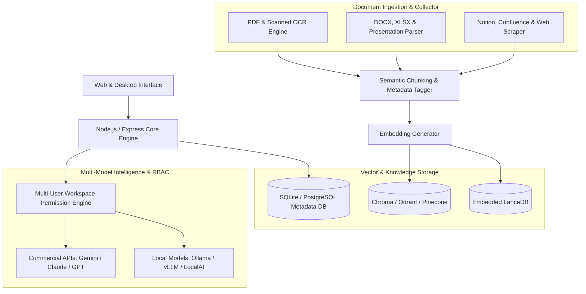

<p align="center">
  
</p>

<h1 align="center">VegaDocs</h1>
<h3 align="center">Air-Gapped Enterprise Document Intelligence & Multi-Model RAG Platform</h3>

<p align="center">
  <strong>The Sapphire Harp Star of Deep Contract Parsing, Vector Search & Privacy-Preserving AI</strong><br />
  Production-Grade, Enterprise Alternative to Public Cloud LLMs for Legal, Healthcare & Defense
</p>

<p align="center">
  <a href="https://github.com/wtfear"></a>
  <a href="https://github.com/wtfear/VegaDocs/actions"></a>
  <a href="./LICENSE"></a>
  <a href="https://nodejs.org"></a>
  <a href="https://react.dev"></a>
  <a href="https://lancedb.github.io/lancedb/"></a>
</p>

---

## 🌟 Executive Overview

**VegaDocs** (named after Alpha Lyrae, the brilliant sapphire-white star of the Lyra constellation) is an MIT-licensed, enterprise-ready **air-gapped document intelligence and Retrieval-Augmented Generation (RAG) platform** built on **React, Node.js, Express, and high-performance vector databases**.

In regulated industries (legal, healthcare, insurance, finance, and aerospace defense), feeding proprietary contracts, patient charts, and technical schematics into multi-tenant public AI platforms is a catastrophic compliance violation. VegaDocs provides **complete data sovereignty**: it runs entirely inside the client's private cloud VPC or local on-premise hardware, offering fine-grained workspace permissions, cited page-level grounding, and support for any local (Ollama, vLLM, LMStudio) or commercial (Gemini, Anthropic, OpenAI) LLM.

---

## 🏛️ Architecture & Operational Capabilities



### 1. 🛡️ Complete Air-Gapped Data Sovereignty
- **Zero Outbound Data Leaks:** Can operate 100% offline using local embedding models and local LLM runners (Ollama, vLLM, GGML/GGUF).
- **Embedded Zero-Config Storage:** Ships with native embedded LanceDB and SQLite, eliminating external database hosting overhead.

### 2. 📑 Grounded Citations & Deep Document Coordinates
- Answers are accompanied by exact, verified citations including source file name, section, and text chunk.
- Eliminates AI hallucination liability in contract analysis, compliance audits, and clinical protocols.

### 3. 👥 Multi-User Workspaces & Granular Governance
- Segment documents into isolated departmental workspaces (e.g., Legal, Executive, HR, Engineering).
- Enforce role-based access control (Admin, Manager, Member) with comprehensive audit trails.

### 4. 🔌 Universal LLM & Vector Database Interoperability
- **Supported LLMs:** Ollama, vLLM, Google Gemini, Anthropic Claude, OpenAI, Groq, Mistral, Together AI, AWS Bedrock.
- **Supported Vector DBs:** LanceDB, Chroma, Pinecone, Qdrant, Weaviate, Milvus, and pgvector.

---

## 🚀 Quick Start (Local Docker)

Launch the full VegaDocs platform in a single command:

```bash
# 1. Clone repository
git clone https://github.com/wtfear/VegaDocs.git
cd VegaDocs

# 2. Start containerized application
docker compose up -d

# 3. Access local document intelligence cockpit
open http://localhost:3001
```

---

## ☁️ Cloud Deployment Options

| Cloud Provider | Mode | Tier | Manifest |
|---|---|---|:---:|
| **Render** | Docker Web Service | Standard | [`render.yaml`](./render.yaml) |
| **AWS / GCP VPS** | Docker Container | \$10–\$40/mo | [`docker-compose.yml`](./docker-compose.yml) |
| **Kubernetes** | Helm Chart | Enterprise Cluster | [`cloud-deployments/helm`](./cloud-deployments/helm) |

---

## 🌌 The WTFear Celestial Enterprise Portfolio

VegaDocs is the document intelligence cornerstone of the **WTFear Celestial AI Suite**:

| Star | Flagship Platform | Category | Stack |
|---|---|---|---|
| 🌟 **Vega** | **`VegaDocs`** | Air-Gapped Document Intelligence & RAG | React, Node.js, Vector DBs |
| 🌟 **Polaris** | **`PolarisERP`** | Autonomous Enterprise ERP, CRM & WMS | Next.js 15, PostgreSQL, TurboRepo |
| 🌟 **Aldebaran** | **`AldebaranCRM`** | Enterprise Sales Pipeline & Quotation CRM | Laravel, Vue.js, MySQL |
| 🌟 **Sirius** | **`SiriusIQ`** | Enterprise Workplace Knowledge OS & RAG | Next.js, FastAPI, Vespa, PostgreSQL |
| 🌟 **Capella** | **`CapellaBI`** | BI-as-Code & Unit Economics Cockpit | DuckDB-WASM, Svelte, SQL |
| 🌟 **Altair** | **`AltairCommerce`** | Headless B2B/D2C Commerce Engine | Node.js, Next.js, Redis, PostgreSQL |
| 🌟 **Arcturus** | **`ArcturusFlow`** | Visual Agentic Workflow & Multi-Agent Builder | Python, React, FastAPI, MCP |

---

## 📄 License & Attribution

- **Core License:** [MIT License](./LICENSE) — 100% Free for commercial, agency, and enterprise client white-label deployments.
- **Upstream Engine:** Built on the battle-tested [AnythingLLM](https://anythingllm.com) core by Mintplex Labs.
- **Maintained & Enhanced by:** [WTFear Agency](https://github.com/wtfear) & **Pavan Kumar Kunukuntla**.
